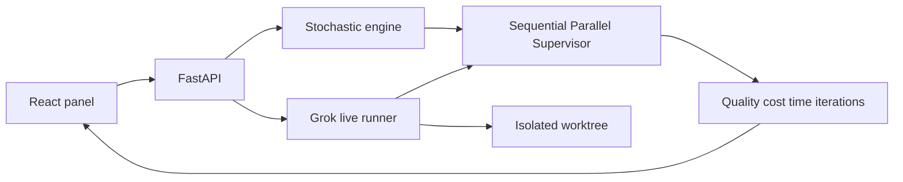

# Agent Team Simulator

Compare three multi-agent coordination patterns on the same programming task graph:

- **Sequential.** Architect, developer, tester, and reviewer run one module at a time.
- **Parallel.** Ready modules fan out in a superstep and meet at a barrier, following the same idea as Microsoft Agent Framework concurrent orchestration. Two developers on one shared surface can conflict.
- **Supervisor.** A manager chooses the next role from remaining budget, failures, and whether quality is still uncertain. This is the Magentic-style pattern: one coordinator, specialist workers.

The statistical comparison is a seeded simulation. A live pass uses the same policies with local Cursor agents (a Grok model when the account has one) on a small Python task.



## Run the simulation

```powershell
cd backend
python -m venv .venv
.venv\Scripts\activate
pip install -e ".[dev]"
uvicorn app.main:app --reload --port 8000
```

In another terminal:

```powershell
cd frontend
npm install
npm run dev
```

Open http://localhost:5173. Choose a scenario, leave the strategy on "Compare all", and run the experiment. The panel reports quality, coordination cost, simulated time, iterations, and win rate.

From `backend`, with the dev extra installed:

```powershell
python -m pytest
```

Scenarios:

- Easy fan-out: independent modules, so parallel work saves time.
- Coupled surfaces: ingest and transform share a surface and can collide.
- High failure rate: agents error or drop handoffs.
- Tight budget: cost, time, or iteration limits stop the run early.

## Live Cursor agents

Live mode runs only the bundled easy task under `tasks/sample_task` (mean, normalize, report). Put your xAI key in `.env` at the project root:

```
XAI_API_KEY=
XAI_MODEL=
```

`XAI_MODEL` is optional. When it is empty, the runner lists the account's models and prefers `grok-4`. The key is loaded from `.env` and is not written into source files. Each pass uses its own git worktree under `.worktrees/` when the repo has a commit, otherwise a copy of the task. Caps: 12 model runs, 15 minutes, one live pass at a time.

Quality in a live pass comes from pytest plus the reviewer's JSON rubric. Cost is the number of model runs. Time is wall-clock seconds. The tester step is pytest itself, not another model call.
